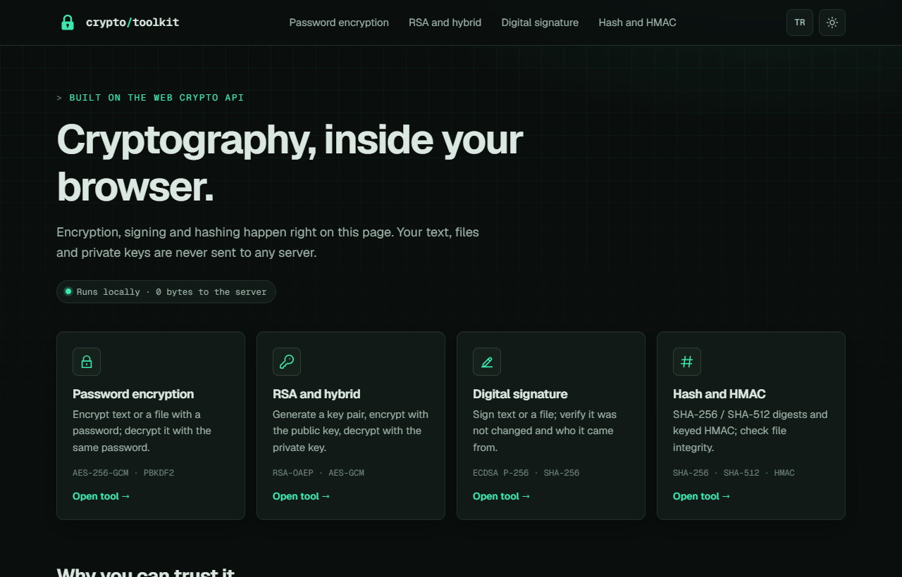
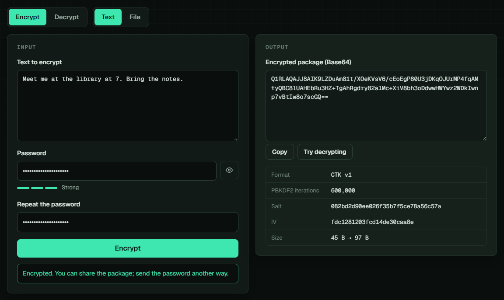
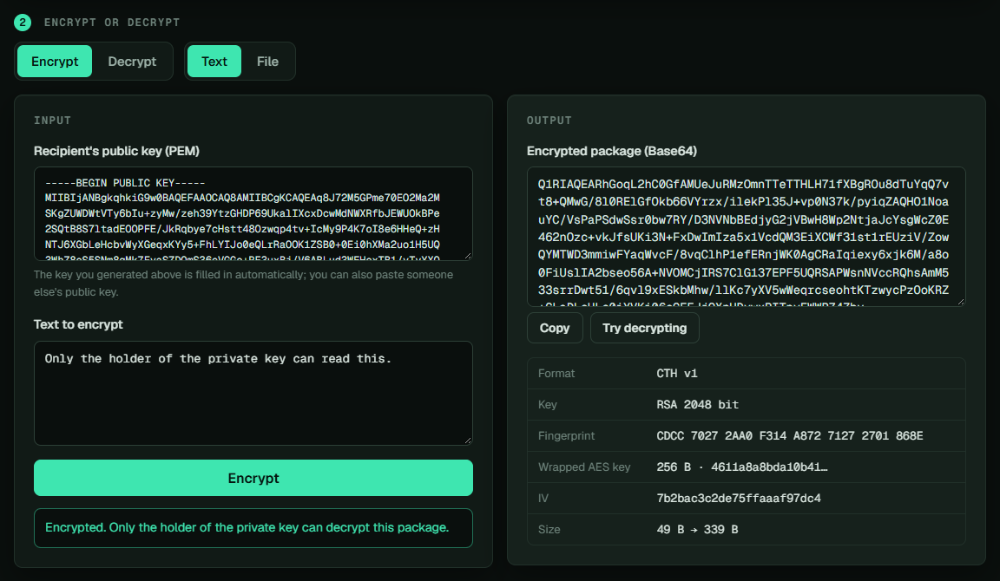
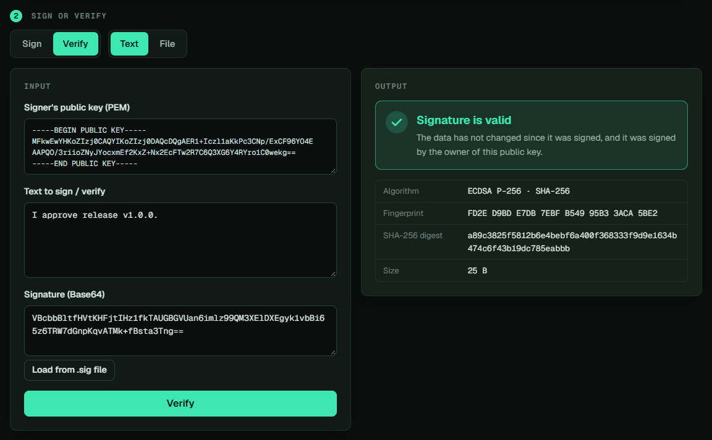
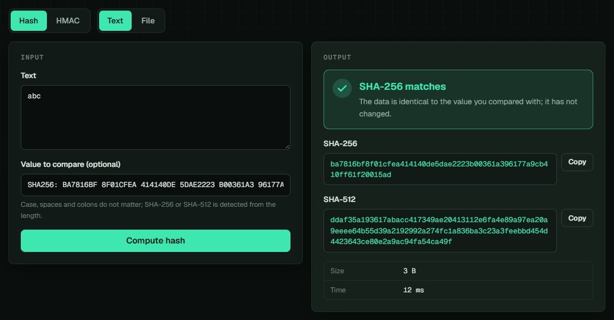
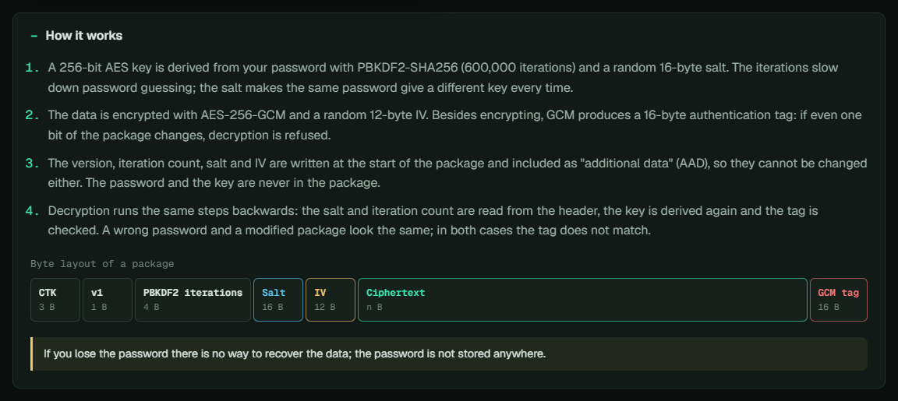
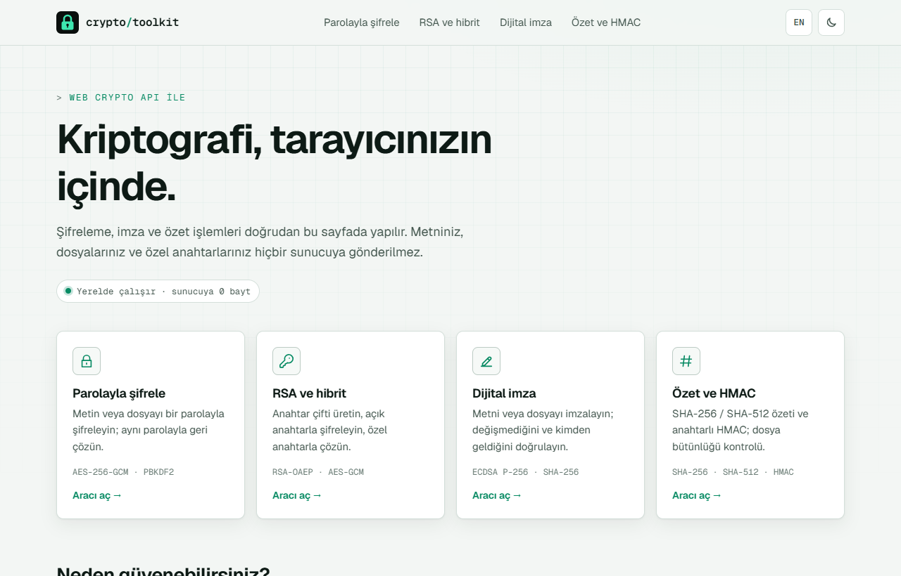
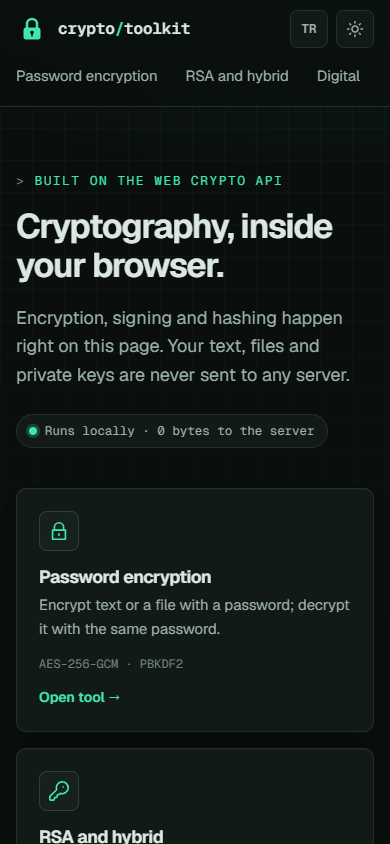

# Crypto Toolkit

[English](README.md) | **Türkçe**

Tarayıcıda çalışan bir kriptografi araç kutusu: metin ve dosyaları parolayla şifreleyin, RSA anahtarları üretip başkası için şifreleyin, verileri imzalayıp doğrulayın, özet (hash) kontrol edin. Bütün işlemler tarayıcının yerleşik Web Crypto API'siyle yapılır; metniniz, dosyalarınız ve özel anahtarlarınız cihazınızdan çıkmaz. Sunucu yalnızca sayfaları gönderir; sayfanın güvenlik politikası da geriye herhangi bir şey göndermesini engeller.

**Canlı demo:** [crypto.miracdeprem.com](https://crypto.miracdeprem.com). Site ücretsiz bir sunucuda çalıştığı için bir süre kullanılmadıktan sonra ilk sayfanın açılması yarım dakika kadar sürebilir.



Proje, *Bilgi Güvenliği ve Kriptografi* dersinin (Bilgisayar Mühendisliği 3. sınıf) final projem olarak başladı. O ilk sürüm şifrelemeyi sunucuda, koda yazılmış bir AES anahtarı ve IV ile yapıyordu; bu sürüm, modern ve kimlik doğrulamalı algoritmalarla tarayıcıda çalışacak şekilde baştan yazıldı.

## Özellikler

**Parolayla şifreleme** (metin ve dosya)
- Paroladan PBKDF2-SHA256 (600.000 tur) ile türetilen anahtarla AES-256-GCM
- Her seferinde yeni, rastgele salt ve IV; aynı metin hiçbir zaman aynı çıktıyı vermez
- Kendini tanımlayan tek bir Base64 paket; başlık dahil herhangi bir baytı değişirse çözme başarısız olur
- Şifrelerken parola tekrarı ve güç ipucu; 100 MB'a kadar dosyalar, `.enc` olarak kaydedilir

**RSA ve hibrit şifreleme**
- 2048, 3072 veya 4096 bitlik RSA-OAEP anahtar çifti üretme; PEM olarak kopyalama ya da indirme
- Herhangi bir açık anahtar için şifreleme: veri AES-GCM ile şifrelenir, RSA ile yalnızca AES anahtarı sarılır
- Anahtarları başka bir kanaldan karşılaştırmak için parmak izi (SHA-256)

**Dijital imza**
- ECDSA P-256 anahtar çifti; metin veya dosya imzalama, imzayı `.sig` olarak indirme
- Açık bir geçerli / geçersiz sonucu, imzalanan özet ve anahtar parmak iziyle doğrulama

**Özet ve HMAC**
- Metin veya dosyanın SHA-256 ve SHA-512 özeti bir arada; gizli anahtarla HMAC-SHA-256 / SHA-512
- İndirilen dosyayı kontrol etmek için yayımlanmış özeti herhangi bir yaygın yazımla yapıştırma; karşılaştırma sabit zamanlı

**Her yerde**
- Her araçta paketlerin bayt düzenini de gösteren bir "Nasıl çalışır?" paneli
- Hata ayrıntısı yerine anlaşılır mesajlar ("parola yanlış ya da paket değiştirilmiş")
- Türkçe ve İngilizce arayüz, koyu "laboratuvar" teması ve açık tema, telefonda da çalışır

## Ekran Görüntüleri

| | |
|---|---|
|  |  |
|  |  |
|  |  |

<p align="center"></p>

## Kullanılan Teknolojiler

- AES-GCM, PBKDF2, RSA-OAEP, ECDSA, SHA-2 ve HMAC için **Web Crypto API** (`crypto.subtle`)
- Framework ve derleme adımı olmayan **sade JavaScript modülleri**; **`node --test`** ile test
- Sayfa kabuğu olarak **C# / ASP.NET Core MVC**: Razor görünümleri, Türkçe ve İngilizce metinler, güvenlik başlıkları, istek sınırlama
- Bellek içi test sunucusuyla **xUnit**
- **Render** üzerinde **Docker**

## Kurulum ve Çalıştırma

[crypto.miracdeprem.com](https://crypto.miracdeprem.com) adresini açın ya da yerelde çalıştırın. Güncel .NET SDK gerekir; Node.js yalnızca JavaScript testleri için gerekir.

```bash
git clone https://github.com/MrcDprm/crypto-toolkit.git
cd crypto-toolkit
dotnet run --project src/CryptoToolkit.Web
```

Ardından `http://localhost:5090` adresini açın. Veritabanı, anahtar veya başka bir ayar gerekmez.

Testleri çalıştırmak için:

```bash
npm test       # kriptografi modülleri (Node.js)
dotnet test    # sunucu: sayfalar, başlıklar, dil, metinler
```

### Proje yapısı

```
src/CryptoToolkit.Web/
  Controllers/          Ana sayfa, araç sayfaları, hata sayfaları
  Models/               Araç listesi ve hata sayfası modeli
  Infrastructure/       Güvenlik başlıkları
  Localization/         JSON tabanlı çeviri
  Resources/            Türkçe ve İngilizce metinler
  Views/                Razor sayfaları
  wwwroot/js/crypto/    Kriptografi: encoding, password, rsa, sign, hash
  wwwroot/js/ui/        Formları modüllere bağlayan sayfa betikleri
tests/
  js/                   Kriptografi modülleri için node --test testleri
  CryptoToolkit.Tests/  Sunucu için xUnit testleri
Dockerfile              Render'da kullanılan konteyner
render.yaml             Render servis tanımı
```

### Paket biçimleri

Şifreli çıktılar ikili (binary) paketlerdir; metin olarak Base64 gösterilir. Bütün tamsayılar big-endian'dır.

| Paket | Düzen |
|---|---|
| Parola (`CTK`) | `"CTK"` · sürüm (1) · tur sayısı (4) · salt (16) · IV (12) · şifreli veri + GCM etiketi (16) |
| Hibrit RSA (`CTH`) | `"CTH"` · sürüm (1) · sarılmış anahtar uzunluğu (2) · sarılmış AES anahtarı · IV (12) · şifreli veri + GCM etiketi (16) |

Şifreli veriden önceki her şey AES-GCM'ye kimliği doğrulanan ek veri (AAD) olarak verilir; böylece başlık da değiştirilemez. Bir paketteki tur sayısı yalnızca 100.000 ile 10.000.000 arasındaysa kabul edilir; sahte bir paket sayfayı donduramaz.

### Güvenlik

- Bütün kriptografi tarayıcıda çalışır; sunucu metin, dosya ya da anahtar almaz
- İçerik Güvenliği Politikası (CSP): yalnızca sitenin kendi script, stil ve fontları; `connect-src 'none'` sayfanın gönderebileceği her isteği engeller; Trusted Types HTML enjeksiyonunu engeller
- Satır içi script veya stil yok, üçüncü taraf kod yok, fontlar sitenin kendisinden gelir
- HSTS, `X-Frame-Options: DENY`, `nosniff`, `no-referrer` ve sıkı bir Permissions Policy; CORS yok
- IP başına istek sınırı, izinli alan adı listesi ve hata ayrıntısı göstermeyen hata sayfaları
- İçe aktarılan özel anahtarlar dışa aktarılamaz; 2048 bitten kısa RSA anahtarları reddedilir
- Bu bir öğrenme projesidir; bağımsız bir güvenlik denetiminden geçmemiştir

## Öğrendiklerim

- **İlk sürümümdeki hatalar.** Ders sürümü şifrelemeyi sunucuda, koda yazılmış bir AES anahtarı ve IV ile yapıyordu. Repo herkese açık olduğu için herkes her şeyi çözebilirdi. Sabit IV'li CBC kullandığı için aynı metin hep aynı çıktıyı veriyordu ve şifreli verideki değişiklikleri hiçbir şey fark etmiyordu. Bunu düzeltirken bir anahtarın neden bir sırdan türemesi, IV'nin neden her seferinde yeni olması ve şifrelemenin neden kimlik doğrulama içermesi gerektiğini öğrendim.
- **Kimlik doğrulamalı şifreleme.** AES-GCM şifrelemenin yanında, bir şey değiştiğinde tutmayan bir etiket de üretir. Paket başlığını ek veri olarak verdim; böylece tur sayısı ve salt bile korunuyor. Yanlış parolanın ve değiştirilmiş paketin GCM için tamamen aynı göründüğünü de öğrendim ve hata mesajını bunu dürüstçe söyleyecek şekilde yazdım.
- **Paroladan anahtar üretmek.** Parola bir anahtar değildir. Rastgele salt ve çok sayıda turla PBKDF2, tahmin saldırılarını yavaşlatır ve aynı parolaların farklı anahtarlar vermesini sağlar. Parolayı Unicode NFC'ye çevirmek gözden kaçıracağım bir ayrıntıydı: "ş" aynı görünen iki farklı şekilde yazılabiliyor.
- **RSA neden AES ile birlikte kullanılır.** RSA ancak birkaç yüz bayt şifreleyebilir; bu yüzden gerçek sistemler (HTTPS, PGP) veriyi yeni bir AES anahtarıyla şifreler ve RSA ile yalnızca o anahtarı sarar. Bunu kendim kurunca hibrit şifreleme, OAEP dolgusu ve anahtar parmak izleri somutlaştı.
- **İmza gizlilik değil, kaynak kanıtlar.** ECDSA verinin SHA-256 özetini imzalar. İmzalı bir mesaj yine okunabilir ve sondaki bir boşluk bile imzayı bozar. Web Crypto'nun imzayı `r‖s` biçiminde, OpenSSL'in ise DER biçiminde verdiğini öğrendim ve anahtarlarımı ve imzalarımı OpenSSL ile doğruladım.
- **"Verin burada kalır" sözünü uygulanabilir yapmak.** Sadece söz vermek yerine, İçerik Güvenliği Politikası sayfanın herhangi bir yere bağlanmasını yasaklıyor; Trusted Types da `innerHTML` tarzı enjeksiyonu durduruyor. İkisini de gerçek bir tarayıcıda test ettim.
- **Kullanıcının gerçekte aldığını test etmek.** NIST ve RFC 4231'in bilinen sonuç testleri, şifreleme ile çözmenin sadece birbirini tutmasını değil, çıktının doğru olduğunu kanıtlıyor. Sunucu testleri gerçek bir hata buldu: istek sınırı aşıldığında hata sayfası da sınırlanıyor ve kullanıcı boş bir sayfa görüyordu.

## Teşekkür

- [Geist ve Geist Mono](https://github.com/vercel/geist-font) fontları, SIL Open Font License ile

## Lisans

[MIT](LICENSE)
